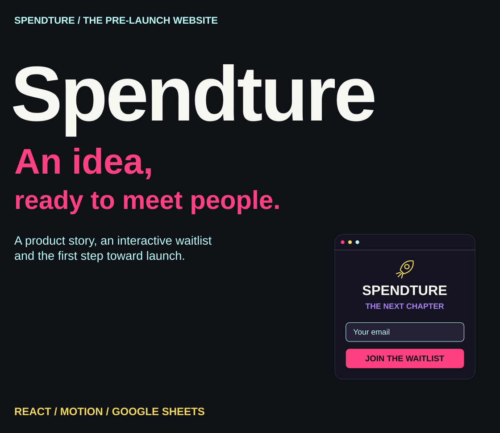
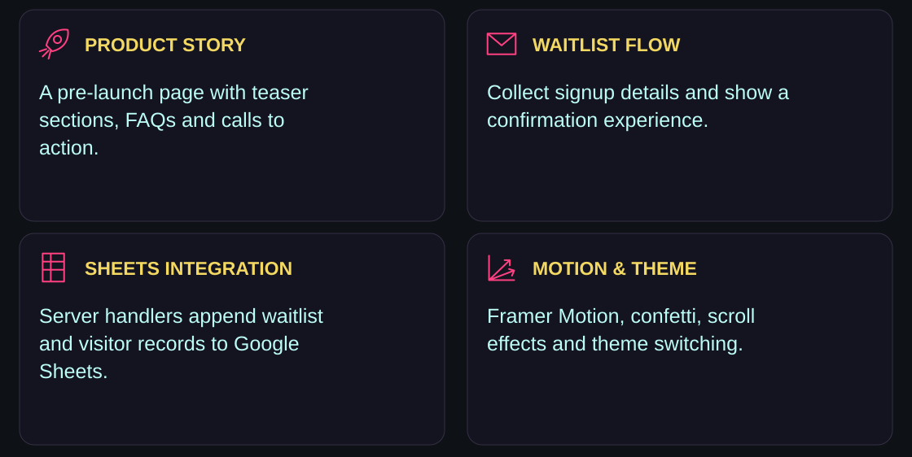
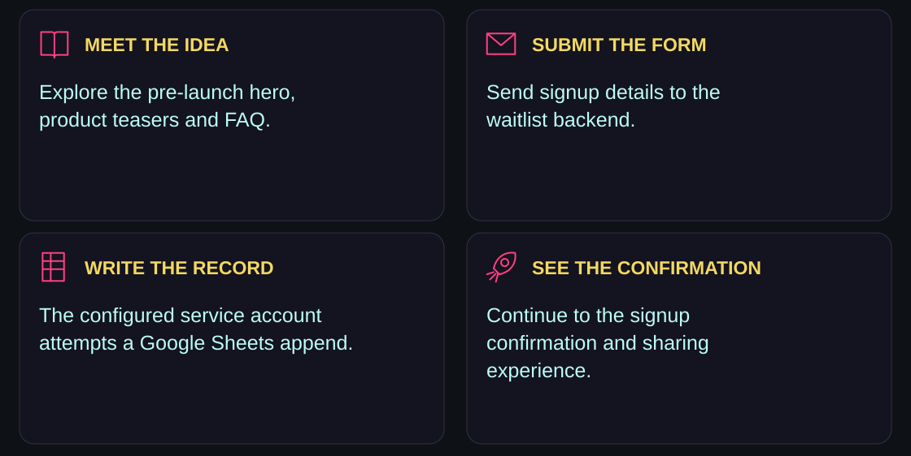
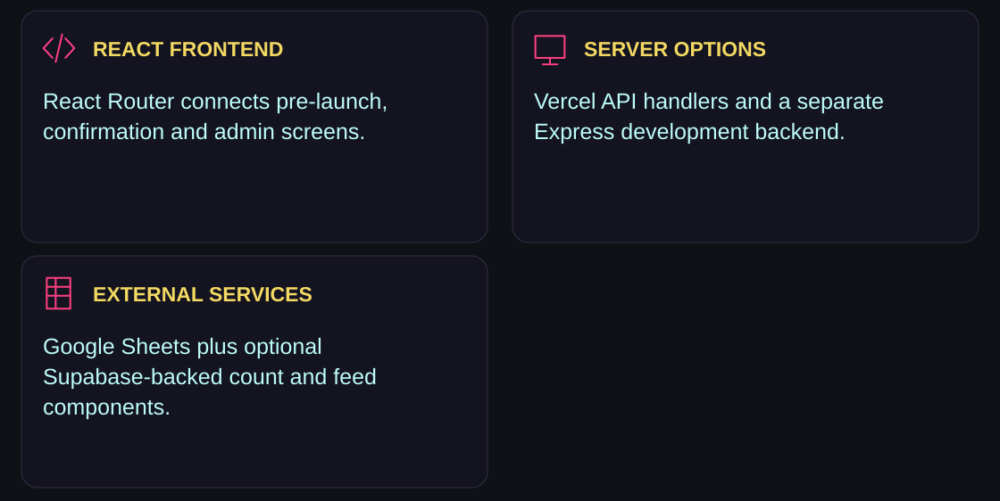
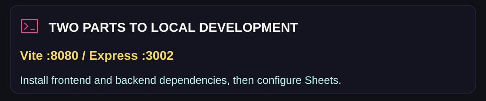
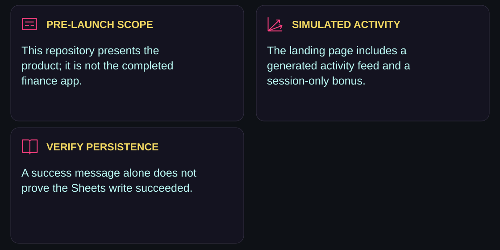
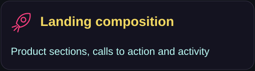
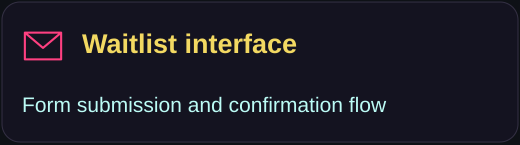
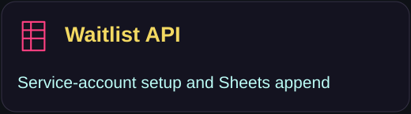
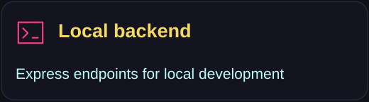

<p><picture><source media="(max-width: 600px)" srcset="assets/readme/hero-mobile.svg"/></picture></p>

<p align="center"><a href="#the-website-i-built">Overview</a> · <a href="#from-interest-to-waitlist">Workflow</a> · <a href="#how-the-pieces-connect">Architecture</a> · <a href="#run-locally">Run locally</a> · <a href="#current-implementation-notes">Scope</a> · <a href="#explore-the-source">Source</a></p>

##  The website I built

This repository holds the pre-launch website for Spendture: a place to introduce the financial-management product idea, explain its direction and collect interest through a waitlist. I built the experience with animated sections, theme controls, signup feedback and sharing prompts.

[Visit the existing Spendture website link](https://www.spendture.com)

<p><picture><source media="(max-width: 600px)" srcset="assets/readme/features-mobile.svg"/></picture></p>

The site includes product teasers, FAQs, a floating call to action, loading and confirmation states, social sharing, and admin/dashboard interfaces. Those interfaces do not establish that the full Spendture finance platform is implemented here.

##  From interest to waitlist

<p><picture><source media="(max-width: 600px)" srcset="assets/readme/workflow-mobile.svg"/></picture></p>

The waitlist endpoint accepts name and email, with additional age, location, role and referral fields. It uses a Google service account to append records to the `Waitlist` sheet. Confirmation and sharing UI continue the launch experience.

The page also mounts a generated activity feed and adds a session-only bonus to displayed signup activity. That visual activity should not be read as independently verified signup volume.

##  How the pieces connect

<p><picture><source media="(max-width: 600px)" srcset="assets/readme/architecture-mobile.svg"/></picture></p>

| Part | Implementation |
|---|---|
| Frontend | React 18, TypeScript, Vite, React Router |
| UI and motion | Tailwind CSS, shadcn/ui, Lucide, Framer Motion, canvas-confetti |
| Hosted endpoints | Vercel functions in `api/` |
| Local endpoints | Express backend in `backend/server.js` |
| Waitlist and visitor storage | Google Sheets API with service-account credentials |
| Count/feed components | Existing Supabase client integration |

The development waitlist call targets `http://localhost:3002/api/waitlist`; production uses `/api/waitlist`. The visitor tracker currently posts to a hard-coded localhost endpoint, so it is not described here as working production analytics.

##  Run locally

<p><picture><source media="(max-width: 600px)" srcset="assets/readme/environment-mobile.svg"/></picture></p>

The original project specifies Node 18 or later. Install the root and backend dependencies:

```bash
git clone https://github.com/adilsukumar/Spendture-Website.git
cd Spendture-Website
npm install
cd backend
npm install
```

Create `backend/.env` using [backend/.env.example](backend/.env.example):

```env
GOOGLE_SHEET_ID=your_sheet_id
GOOGLE_SERVICE_ACCOUNT_EMAIL=your_service_account@project.iam.gserviceaccount.com
GOOGLE_PRIVATE_KEY="your_private_key"
```

Enable the Google Sheets API for the service account and share the target spreadsheet with its email. See [GOOGLE_SHEETS_SETUP.md](backend/GOOGLE_SHEETS_SETUP.md) for the repository’s setup notes. Keep these credentials on the backend; do not use a `VITE_` prefix for a private key.

From `backend/`, start the API server:

```bash
npm start
```

In another terminal, from the repository root:

```bash
npm run dev
```

Vite is configured for `http://localhost:8080`; the backend defaults to port `3002`. After both dependency installs and backend configuration, `npm run start:all` from the root is also declared as a combined start command.

### Build and lint

```bash
npm run lint
npm run build
npm run preview
```

The root also declares `npm run build:dev`. It has no dedicated automated test script. Starting Vite alone previews the interface; it does not provision the external data services.

### Vercel deployment

Import **Spendture-Website** as a Vite project. Configure `GOOGLE_SHEET_ID`, `GOOGLE_SERVICE_ACCOUNT_EMAIL` and `GOOGLE_PRIVATE_KEY` in the server environment, then deploy the frontend with its `api/` handlers. An optional CLI route from the repository root is:

```bash
npm i -g vercel
vercel
```

The hosted handlers append to the named `Waitlist` and `Visitors` sheet tabs. Verify those tabs and inspect an actual appended row after a test submission. A response marked successful is not sufficient evidence of persistence in this implementation.

##  Current implementation notes

<p><picture><source media="(max-width: 600px)" srcset="assets/readme/scope-mobile.svg"/></picture></p>

<details>
<summary><strong>What to inspect when evaluating or deploying</strong></summary>

- The landing page includes `FakeActivityFeed` and a session-only signup bonus; these are generated UI activity, not measured growth.
- The waitlist API returns `success: true` even when a Sheets append fails, with debugging detail in the response. The visitor API also catches failures without reporting them as failures to the client.
- `VisitorTracker` contacts an external IP/location service and currently posts to localhost. Treat production tracking as an integration to verify, not a guaranteed analytics pipeline.
- The current auth hook simulates local sign-in. Admin screens are interface work, not proof of a complete production authorization boundary.
- Supabase-backed count/feed components require their own matching configuration; setting Sheets credentials alone does not provision them.
- This README makes no blanket claim of regulatory compliance or verified security from the presence of privacy pages or environment variables.

</details>

Waitlist fields and visitor metadata are data collection, rather than browser-only storage. Review the configured endpoints, third-party requests and privacy-page wording together before collecting real information.

##  Explore the source

<p align="center"><a href="src/pages/PreLaunchIndex.tsx"></a> <a href="src/components/WaitlistSection.tsx"></a> <a href="api/waitlist.js"></a> <a href="backend/server.js"></a></p>

| Area | Source |
|---|---|
| Routes and providers | [App.tsx](src/App.tsx) |
| Signup confirmation | [WaitlistConfirmation.tsx](src/pages/WaitlistConfirmation.tsx) |
| Signup celebrations | [ConfettiCelebration.tsx](src/components/ConfettiCelebration.tsx) |
| Generated activity | [FakeActivityFeed.tsx](src/components/FakeActivityFeed.tsx) |
| Visitor client and server handler | [VisitorTracker.tsx](src/components/VisitorTracker.tsx) · [track-visitor.js](api/track-visitor.js) |
| Auth interface state | [useAuth.tsx](src/hooks/useAuth.tsx) |
| Admin interface | [src/pages/admin/](src/pages/admin/) |

```text
src/components/        product sections, forms, motion and UI
src/pages/             pre-launch, confirmation, policy and admin pages
src/hooks/             API helpers, auth state and scroll behavior
api/                   hosted serverless handlers
backend/               local Express server and Sheets setup notes
public/                static branding and site assets
```

##  License and contact

Spendture’s existing [proprietary license](LICENSE) governs the source and documentation. See that file for restrictions and permissions, or contact [official.spendture@gmail.com](mailto:official.spendture@gmail.com) for project inquiries.

[Website](https://www.spendture.com) · [LinkedIn](https://linkedin.com/company/spendture) · [Twitter](https://twitter.com/spendture)

<p><picture><source media="(max-width: 600px)" srcset="assets/readme/closing-mobile.svg"/></picture></p>

<p align="center"><a href="https://github.com/adilsukumar/Spendture-Website/issues">Discuss an improvement</a> · <a href="src/pages/PreLaunchIndex.tsx">Explore the launch experience</a> · <a href="https://www.adilsukumar.xyz/">Meet the builder</a></p>
